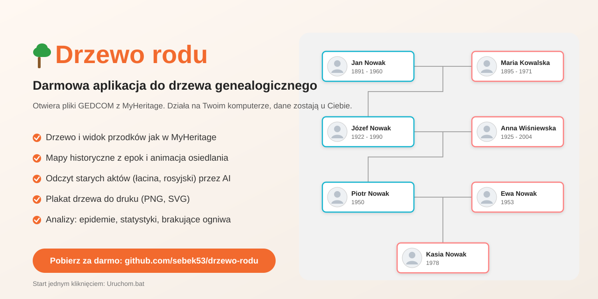
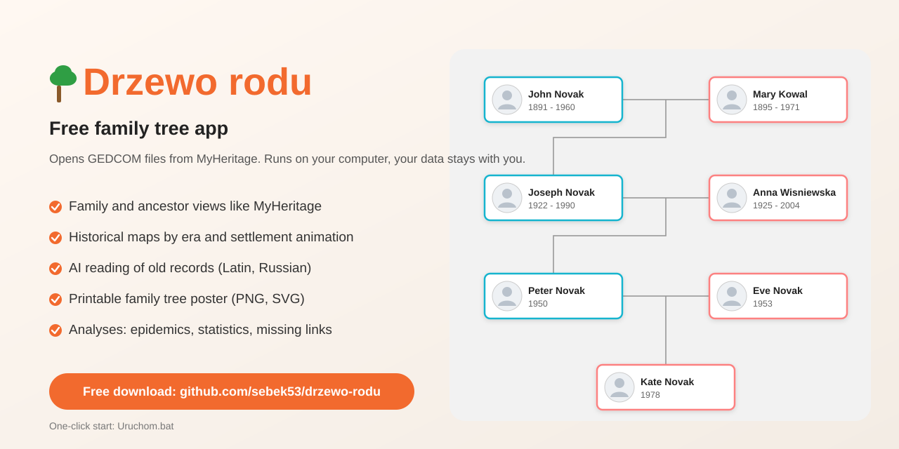
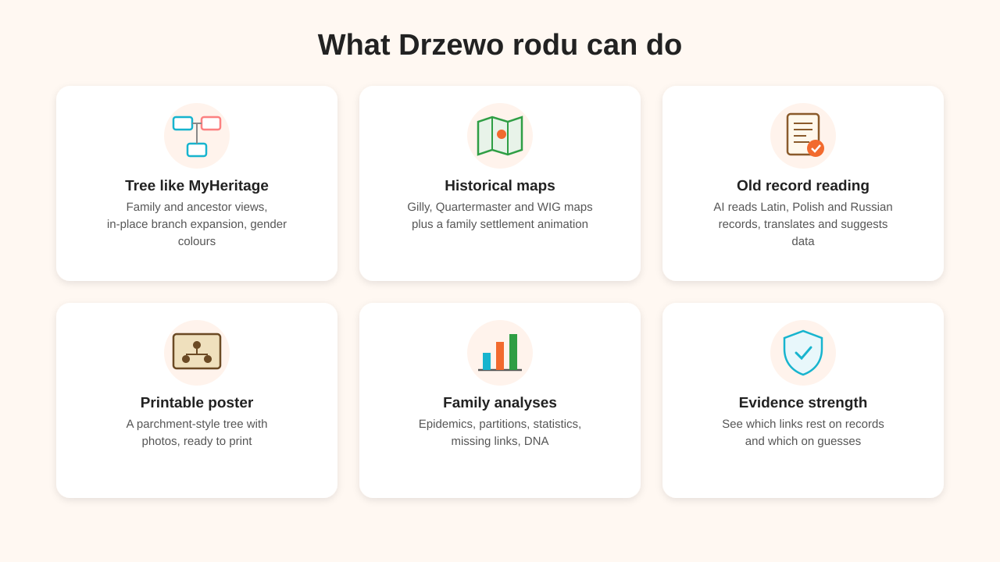
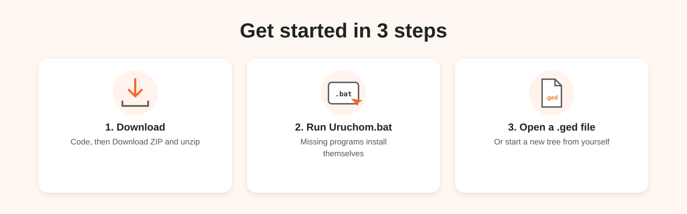
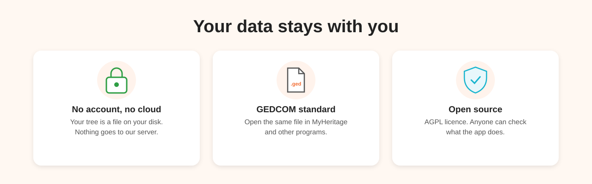
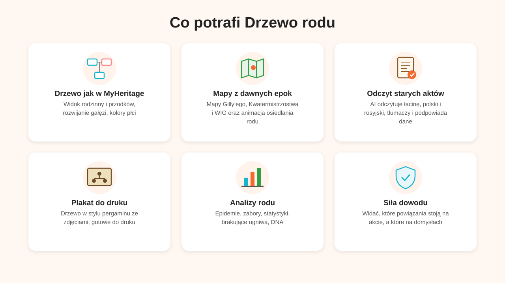
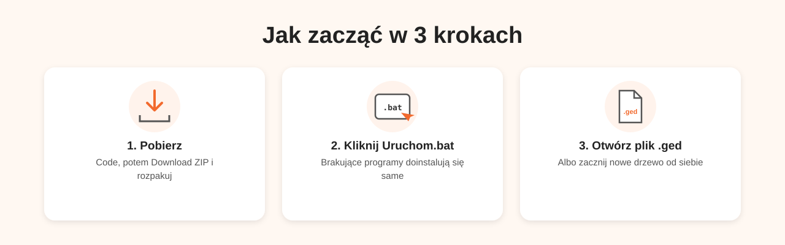
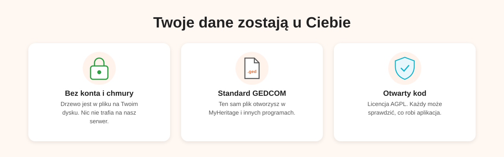

# Drzewo rodu

## 👉 [Otwórz aplikację](https://sebek53.github.io/drzewo-rodu/) · [Open the app](https://sebek53.github.io/drzewo-rodu/)

Nic nie trzeba instalować: kliknij link, otwórz swój plik .ged albo zacznij nowe drzewo. Dane zostają na Twoim komputerze, nic nie trafia na serwer. *No install needed: click the link, open your .ged file or start a new tree. Your data stays on your computer.*

🇬🇧 

*Family tree app for GEDCOM files (e.g. MyHeritage export). English interface: ☰ menu → Język / Language → English. Start: open https://sebek53.github.io/drzewo-rodu/ (or download ZIP and double-click `Uruchom.bat` (Windows) or `Uruchom.command` (macOS/Linux)).*

Przeglądarkowa aplikacja do prowadzenia drzewa genealogicznego z pliku GEDCOM (.ged, np. eksport z MyHeritage).

**Funkcje:** drzewo z rozwijaniem gałęzi w miejscu, profil osoby, edycja, zdjęcia, notatki badawcze, mapa z animacją migracji, detektyw sprzeczności dat, sieć powiązań, życie na tle historii, „gdzie szukać dalej”, wyszukiwanie w serwisach genealogicznych, odczyt aktów przez Claude.

## Wersja na dysk (dla chętnych)
1. Pobierz projekt (zielony przycisk **Code → Download ZIP**) i rozpakuj.
2. **Windows:** kliknij dwukrotnie **`Uruchom.bat`**.
   **macOS / Linux:** kliknij dwukrotnie **`Uruchom.command`** (za pierwszym razem: prawy klik → Otwórz).
3. Aplikacja sama otworzy się w przeglądarce. Wczytaj swój plik .ged (☰ → Otwórz plik).

Plik startowy sam sprawdza, czego brakuje:
- Python nie jest potrzebny: bez niego Uruchom.bat otwiera drzewo.html wprost w przeglądarce (możesz też po prostu kliknąć dwa razy drzewo.html). Odczyt aktów działa wtedy z kluczem Claude wpisanym w menu ☰,
- doinstalowuje bibliotekę do odczytu aktów,
- uruchamia serwer i otwiera przeglądarkę (ponowne kliknięcie tylko otwiera przeglądarkę).

Nie zamykaj czarnego okna, dopóki korzystasz z aplikacji. Najlepiej działa w **Chrome lub Edge** (zapis do pliku .ged i listów).

**Odczyt aktów przez Claude (opcjonalnie):** w aplikacji ☰ → *Klucz Claude* wklej swój klucz z [console.anthropic.com](https://console.anthropic.com/settings/keys) (płacisz Anthropic za własne odczyty). Zaawansowani mogą zamiast tego użyć pliku `.env`.

Dla zaawansowanych: `python serwer.py [port]` (domyślnie 8770).

## Wsparcie / Support
Aplikacja jest darmowa. Jeśli Ci pomogła, możesz postawić autorowi kawę – przycisk jest też w menu ☰.

☕ [buycoffee.to/sebastian.garstka](https://buycoffee.to/sebastian.garstka) (BLIK, przelew) · [ko-fi.com/sebastiangarstka](https://ko-fi.com/sebastiangarstka)

## Licencja / License
Copyright © 2026 Sebastian Garstka. Program udostępniony na licencji **GNU AGPL v3** (plik [LICENSE](LICENSE)): możesz go używać, zmieniać i rozpowszechniać, także komercyjnie, pod warunkiem że zmieniony kod – również gdy udostępniasz program innym przez internet – udostępnisz na tej samej licencji, z informacją o autorze.

*Licensed under the GNU Affero General Public License v3.0.*
